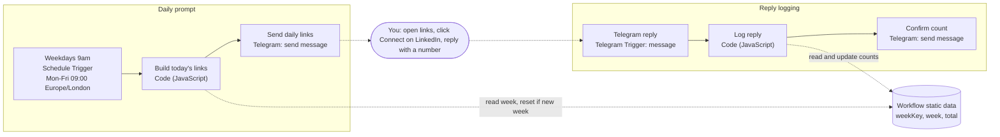

# n8n-workflows

A growing collection of production-style n8n workflows. Every export is stripped of credentials, credential IDs, chat IDs and pinned data, and comes with its own setup notes.

| Workflow | What it does | Status |
|---|---|---|
| [LinkedIn connection nudge](#linkedin-connection-nudge) | Weekday Telegram prompt with LinkedIn search links, plus a reply-based weekly invite counter | Available |

## Repository layout

```
workflows/   n8n workflow exports (import via Workflows > Import from File)
LICENSE
README.md
```

---

## LinkedIn connection nudge

Sending a steady, capped number of relevant LinkedIn connection requests each weekday, without automating LinkedIn.

**Status:** both Code nodes are tested against sample inputs (daily message, logging a count, `/stats`, ignoring other chats, the weekly cap). It has not yet been run on a live n8n instance.

### What it does

- Every weekday at 09:00 (Europe/London) it sends you a Telegram message with six LinkedIn people-search links and a suggested number of invites for each, 20 a day in total.
- You reply to the bot with how many invites you sent. It adds that to a weekly and an all-time count, and `/stats` returns both.
- It enforces a weekly cap of 100. Today's target shrinks as the week fills up, and once the cap is reached the morning message says no invites today.

### Architecture



| Node | Type | What it does |
|---|---|---|
| Note | Sticky note | Setup reminder on the canvas. |
| Weekdays 9am | Schedule Trigger | Cron `0 9 * * 1-5`. The workflow timezone is Europe/London. |
| Build today's links | Code | Builds six people-search URLs: UK-filtered except the company search, and limited to 2nd-degree connections from `SECOND_DEGREE_FROM` onwards. Picks one of `TARGET_COMPANIES` by day of week. Resets the weekly count if a new UK week has started, then sets today's target to `min(20, WEEKLY_LIMIT - sent this week)`. Returns an HTML message, or a "weekly limit reached" message instead. |
| Send daily links | Telegram | Sends the message to your chat ID with HTML parse mode and link previews off. |
| Telegram reply | Telegram Trigger | Fires on each new message to the bot. |
| Log reply | Code | Drops messages from any chat except `ALLOWED_CHAT_ID`. A whole number (up to three digits) is added to the weekly and all-time counts; `/stats` returns both; anything else gets a usage hint. |
| Confirm count | Telegram | Replies in the same chat with the result. |

Stack: n8n (Schedule Trigger, Code node in JavaScript, Telegram node, Telegram Trigger), Telegram Bot API, n8n workflow static data.

### Run it locally

There is no build step, `package.json`, `docker-compose` or `.env` file. Configuration lives in one n8n credential and in constants at the top of the two Code nodes.

**Prerequisites**

- An n8n 1.x instance, either n8n Cloud or self-hosted ([n8n hosting docs](https://docs.n8n.io/hosting/)). The nodes used are Schedule Trigger 1.2, Code 2, Telegram 1.2 and Telegram Trigger 1.1.
- Telegram only delivers webhooks to public HTTPS URLs, so the Telegram Trigger needs n8n reachable over HTTPS. When self-hosting, set `WEBHOOK_URL` to that public address.
- A Telegram bot token from @BotFather. Use a dedicated bot, because Telegram allows only one webhook per bot.

**Credentials (by type)**

| Credential type | Used by |
|---|---|
| Telegram API (bot access token) | Send daily links, Telegram reply, Confirm count |

**Setup**

1. In n8n, create a **Telegram API** credential with your bot token.
2. Import `workflows/linkedin-connection-nudge.json` (Workflows > Import from File).
3. Select the credential on **Send daily links**, **Telegram reply** and **Confirm count**.
4. Get your chat ID: open **Telegram reply**, listen for a test event, message your bot, then copy `message.chat.id` from the output.
5. Replace `PASTE_YOUR_CHAT_ID` in two places: the Chat ID field of **Send daily links**, and `ALLOWED_CHAT_ID` in **Log reply**.
6. Optional: edit the constants at the top of **Build today's links**:
   - `SECOND_DEGREE_FROM`: the date from which searches show 2nd-degree connections only
   - `WEEKLY_LIMIT`: the weekly cap (also set in **Log reply**, so keep the two in step)
   - `TARGET_COMPANIES`: the companies it rotates through (the export ships with placeholders)
   - `LOCAL_SEARCH`: the keywords for local tech people
   - `segments`: the search keywords and how many invites to suggest for each
7. Activate the workflow. Counts only persist in active (production) executions, not in manual test runs.

### Key decisions

- **Human in the loop.** The workflow never calls LinkedIn. It only builds search URLs; you read the headlines and click Connect yourself, which avoids the account risk of automating invites.
- **Workflow static data instead of a sheet.** The only state is three values (`weekKey`, `week`, `total`), shared by two branches of the same workflow. `$getWorkflowStaticData('global')` holds them with no extra credential, service or API call. The trade-off is that there's no history, and the values are lost if the workflow is deleted or re-imported.
- **Weekly limit guard.** The daily target is `min(20, WEEKLY_LIMIT - sent this week)`. At the limit, the morning message says no invites today, and the reply branch tells you to stop until Monday. The count resets automatically when a new week starts.

### Production notes

- **Security:** The export contains no credentials, credential IDs, webhook IDs, chat IDs or pinned data. The bot token stays in n8n's credential store. **Log reply** ignores every chat except `ALLOWED_CHAT_ID`, so anyone else who finds the bot can't change your counts and gets no reply.
- **Monitoring:** None built in. The bot's confirmation reply is the only signal that a count was logged.
- **Cost controls:** No paid APIs. It runs once each weekday, plus once per message to the bot. On n8n Cloud, each run counts as an execution.
- **Known limitations:**
  - Counts are self-reported; nothing checks them against LinkedIn.
  - Four target companies rotate across five weekdays, so one company comes up twice a week.
  - `WEEKLY_LIMIT` is defined separately in both Code nodes.
- **Time zone:** week boundaries use UK wall-clock time (Europe/London, including BST), not the server's UTC clock.
- **Possible next step (not started):** an n8n error workflow for failure alerts.

---

## Coming next

- **Planned:** Trade-business lead capture pipeline (sanitised export)
- **Planned:** YouTube thumbnail generator (multi-provider image pipeline)

## Licence

MIT. See [LICENSE](LICENSE).
